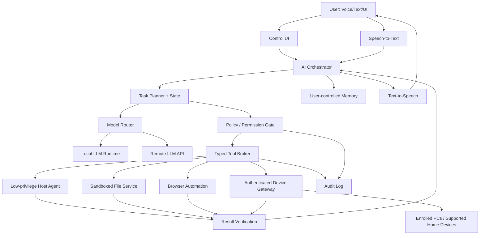

# System Architecture

## Product goal
A personal AI computer platform combining selected hardware, a customized Linux-based OS, an AI orchestrator, Hindi/Hinglish voice, local/cloud model adapters, permissioned host tools, and an authenticated gateway for enrolled PCs and supported home devices.

## Architecture

## Components
- `control-ui`: chat, push-to-talk, task status, permissions and history.
- `voice-service`: STT/TTS; wake word optional and off initially.
- `orchestrator`: plan, task state, cancellation, limits.
- `model-router`: model/provider adapters; privacy/cost/latency routing.
- `policy-engine`: independently checks risk and permissions.
- `tool-broker`: allowlisted typed tool calls; never executes raw LLM shell text.
- `host-agent`: narrow API, dedicated unprivileged account.
- `device-gateway`: device enrollment, identity, capability checks, revocation.
- `memory-service`: inspectable/editable/deletable user-approved memory.
- `audit-service`: action, approval, target, result; redact secrets.
- `update-recovery`: integrity-checked updates, rollback and recovery media.

## Request lifecycle
1. Receive text/voice; show recognized transcript for consequential commands.
2. Classify task and build a bounded plan.
3. Choose local/cloud model based on task, privacy, availability and budget.
4. Validate each proposed tool call outside the LLM.
5. Ask confirmation for destructive, privileged, external or physical-impact actions.
6. Execute one step with timeout, resource cap and cancellation support.
7. Verify outcome from actual tool/device evidence.
8. Log outcome without secrets; respond in text/voice.

## Trust boundaries and non-goals
Voice, documents, websites, and LLM output are untrusted. The LLM cannot grant itself permissions. First release is not a new kernel, custom CPU, unrestricted root shell, or unauthenticated home-network controller.
